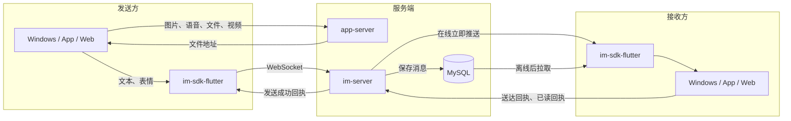
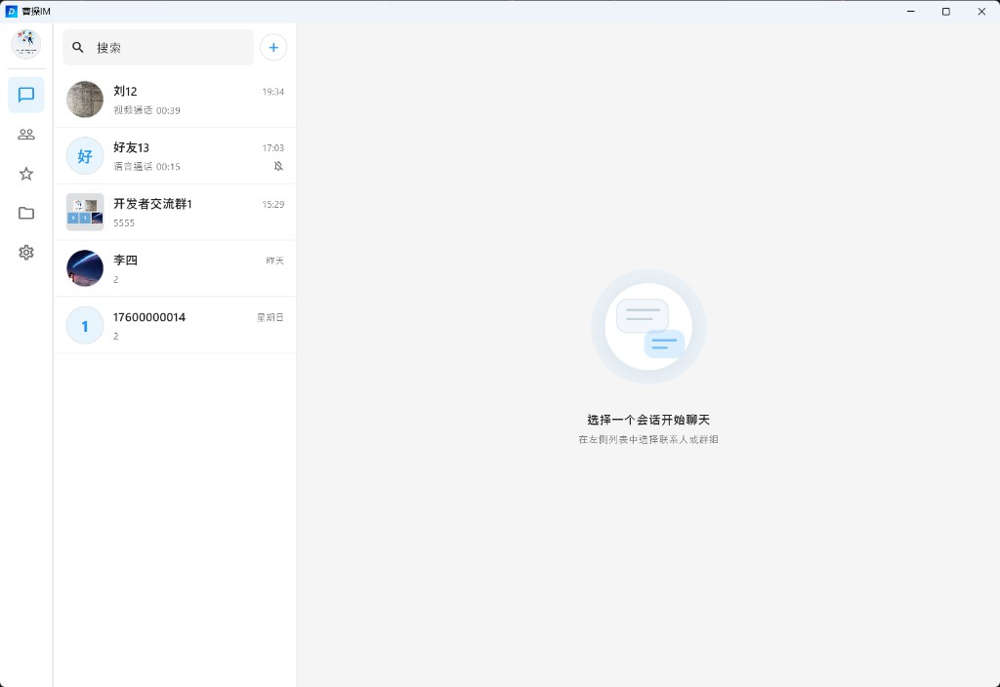
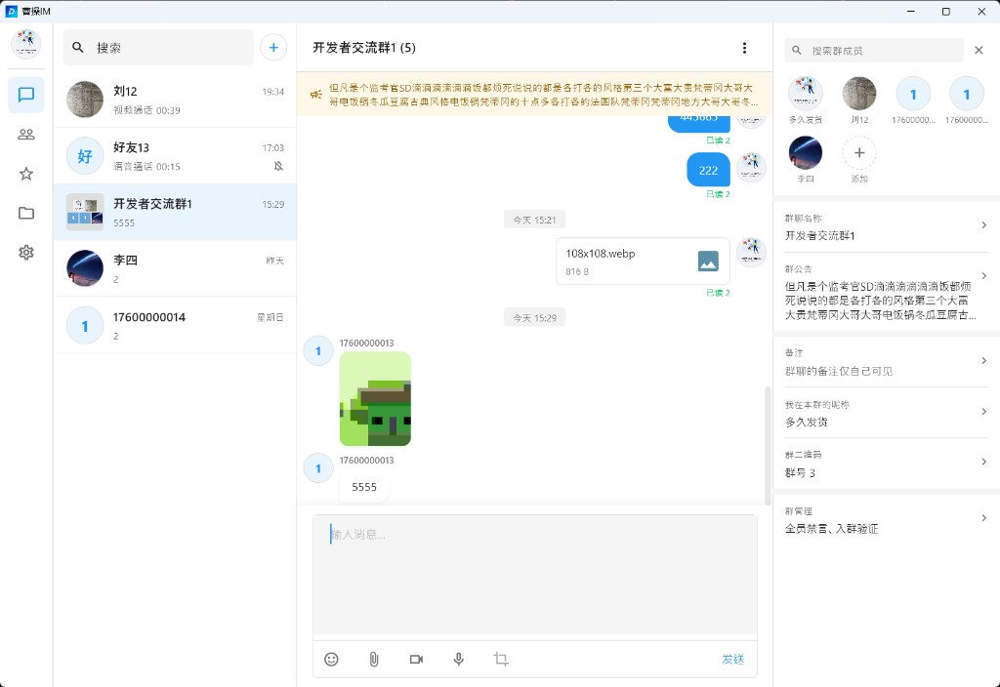
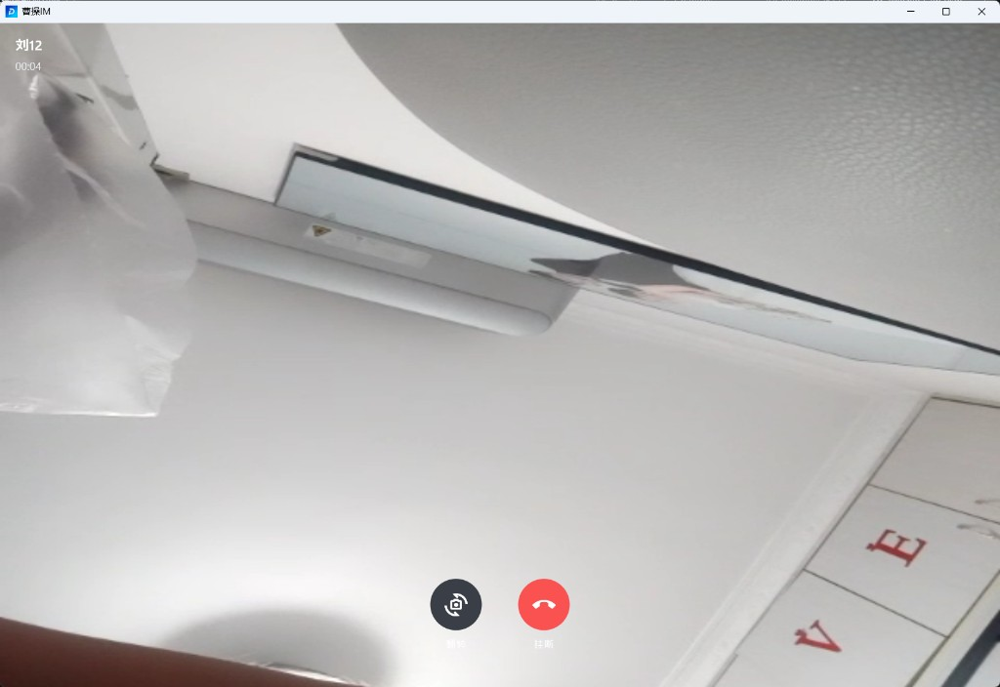
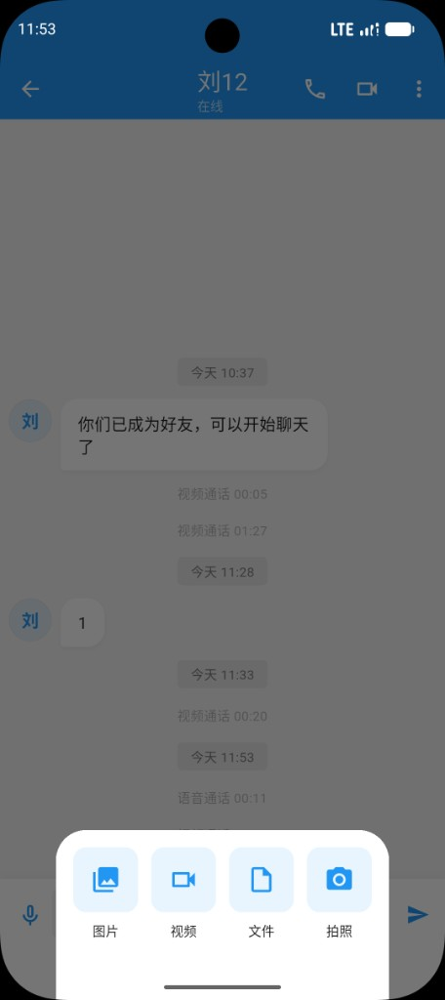
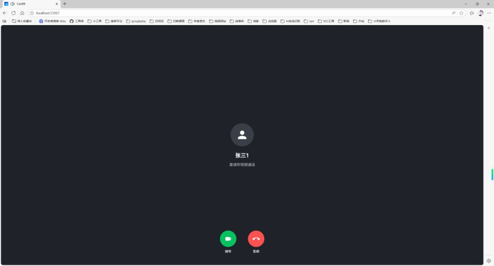

# im-admin

CaoIM 运营后台。管理员在这里查看用户和群、启停账号、解散群、检索消息、维护敏感词和系统配置，并管理后台自己的账号、角色和菜单。聊天长连接仍由 im-server 处理。

```
im-admin/
├── admin-server/    # Spring Boot API，端口 8082，库 cao_im_admin
└── admin-web/       # Vue 3 + Vite + Element Plus，开发端口 5173
```

后台不连接 `cao_im_db`。用户、群、消息、敏感词和系统配置都通过 Feign 调用 im-server 的 `/api/admin/**`，请求头带 `X-Internal-Token`。

## 仓库一览

| 仓库 | 作用 | GitHub | Gitee |
|------|------|--------|-------|
| im-server | 消息与长连接。好友、群、历史、已读、离线同步和一对一通话信令。端口 8080，库 `cao_im_db` | [im-server](https://github.com/cao-im/im-server) | [im-server](https://gitee.com/cao-im/im-server) |
| app-server | 客户端注册、登录、个人资料和文件上传。端口 8081，库 `cao_im_app_server` | [app-server](https://github.com/cao-im/app-server) | [app-server](https://gitee.com/cao-im/app-server) |
| im-admin | 本仓库。运营后台：用户启停、群、消息检索、敏感词、系统配置、角色和审计。API 端口 8082，页面开发端口 5173，库 `cao_im_admin` | [im-admin](https://github.com/cao-im/im-admin) | [im-admin](https://gitee.com/cao-im/im-admin) |
| im-sdk-flutter | Flutter SDK。负责 WebSocket、本地消息库、会话、群和通话信令，不包含界面 | [im-sdk-flutter](https://github.com/cao-im/im-sdk-flutter) | [im-sdk-flutter](https://gitee.com/cao-im/im-sdk-flutter) |
| flutter-demo | 客户端。同一套代码运行在 Windows、macOS、Android、iOS 和 Web | [flutter-demo](https://github.com/cao-im/flutter-demo) | [flutter-demo](https://gitee.com/cao-im/flutter-demo) |

## 消息收发流程

文本和表情由 SDK 通过 WebSocket 发给 im-server。图片、语音、文件和短视频先上传到 app-server，消息里只保存文件地址。服务端写入 MySQL 后，对方在线就立即推送，不在线就等对方上线再拉取。接收方展示后，再回送达回执和已读回执。



## 客户端界面

本仓库管理的是下面这套客户端里的用户、群和消息。界面分别来自 Windows、手机和浏览器。

### Windows

<table>
  <tr>
    <td align="center"><br/><b>会话列表</b></td>
    <td align="center"><br/><b>私聊</b></td>
  </tr>
  <tr>
    <td align="center"><br/><b>群资料</b></td>
    <td align="center"><br/><b>通讯录</b></td>
  </tr>
  <tr>
    <td align="center"><br/><b>联系人资料</b></td>
    <td align="center"><br/><b>语音呼叫</b></td>
  </tr>
  <tr>
    <td align="center" colspan="2"><br/><b>视频通话</b></td>
  </tr>
</table>

### App

<table>
  <tr>
    <td align="center"><br/><b>消息</b></td>
    <td align="center"><br/><b>私聊</b></td>
    <td align="center"><br/><b>通讯录</b></td>
    <td align="center"><br/><b>个人资料</b></td>
  </tr>
  <tr>
    <td align="center"><br/><b>表情</b></td>
    <td align="center"><br/><b>图片、视频、文件</b></td>
    <td align="center"><br/><b>语音呼叫</b></td>
    <td align="center"><br/><b>视频通话</b></td>
  </tr>
</table>

### Web

<table>
  <tr>
    <td align="center"><br/><b>群聊</b></td>
    <td align="center"><br/><b>群资料</b></td>
  </tr>
  <tr>
    <td align="center"><br/><b>通讯录</b></td>
    <td align="center"><br/><b>语音呼叫</b></td>
  </tr>
  <tr>
    <td align="center" colspan="2"><br/><b>视频来电</b></td>
  </tr>
</table>

## 功能特性

登录

- 管理员登录、退出
- 修改自己的密码
- 初始超级管理员 `admin` / `admin123`

运营

- 概览：用户数、群数、消息量
- 用户分页、搜索
- 禁用或启用账号。禁用后无法登录和建立长连接
- 群分页、搜索
- 解散群
- 按用户、群、时间检索消息
- 敏感词
- 系统配置

权限

- 管理员
- 角色
- 菜单
- 操作审计

## 环境

| 环境 | 版本 |
|------|------|
| JDK | 17 及以上 |
| Maven | 3.6 及以上 |
| MySQL | 5.7 及以上 |
| Node.js | 18 及以上，仅前端需要 |

`admin-server` 依赖 `com.caoim:im-core:1.0.0`，使用其中的实体和 Feign 契约。

## 本地启动

im-server 先启动。三个服务的内部 Token 必须一致。

```bash
mysql -u root -p -e "CREATE DATABASE IF NOT EXISTS cao_im_admin DEFAULT CHARACTER SET utf8mb4 COLLATE utf8mb4_unicode_ci;"

cd im-server
mvn clean install -DskipTests

cd ../im-admin/admin-server
mvn spring-boot:run
```

`spring.sql.init.mode` 为 `always`，启动时执行 `admin-server/src/main/resources/schema.sql` 建表。库要事先建好，脚本只建表。没有管理员时，`DataInitializer` 会写入 `admin` / `admin123`。

```bash
cd im-admin/admin-web
npm install
npm run dev
```

打开 http://localhost:5173 。Vite 把 `/api` 代理到 `http://localhost:8082`。

API 文档：http://localhost:8082/swagger-ui/index.html

`admin-server/src/main/resources/application.yml` 里需要核对：

| 配置 | 说明 |
|------|------|
| `spring.datasource` | 指向 `cao_im_admin` |
| `im.server.url` | 默认 `http://localhost:8080/api` |
| `im.server.internal-token` | 与 im-server 的 `im.internal-token` 相同 |
| `jwt.secret` | 只用于后台登录 Token，与两端用户 Token 无关 |

## 生产部署

```bash
cd admin-server
mvn clean package -DskipTests
java -jar target/admin-server-1.0.0.jar --spring.config.location=file:./config/application.yml

cd ../admin-web
npm install
npm run build
```

`admin-web/dist` 用 Nginx 托管。把页面上的 `/api` 反代到 `127.0.0.1:8082`。上线后立刻修改初始密码，并更换 `jwt.secret` 与内部 Token。

## 后台接口

登录后除 `/api/auth/login` 外都要带后台 JWT。

| 方法 | 路径 | 说明 |
|------|------|------|
| POST | `/api/auth/login` | 登录 |
| POST | `/api/auth/logout` | 退出 |
| GET | `/api/auth/me` | 当前管理员、角色和菜单 |
| PUT | `/api/auth/password` | 修改自己的密码 |
| GET | `/api/im/stats` | 概览 |
| GET | `/api/im/users` | 用户分页 |
| PUT | `/api/im/users/{id}/enabled` | 启停用户 |
| GET | `/api/im/groups` | 群分页 |
| PUT | `/api/im/groups/{id}/dismiss` | 解散群 |
| GET | `/api/im/messages` | 消息检索 |
| GET/POST/PUT/DELETE | `/api/im/sensitive-words` | 敏感词 |
| GET/PUT | `/api/im/configs` | 系统配置 |
| * | `/api/system/admins` | 管理员 |
| * | `/api/system/roles` | 角色及菜单授权 |
| * | `/api/system/menus` | 菜单 |
| GET | `/api/system/audits` | 审计日志 |

## 页面

`admin-web/src/views`：登录、概览、用户、群、消息、敏感词、系统配置、管理员、角色、菜单、审计。

## 常见问题

### 语音消息能转文字吗？

当前版本没有语音转文字。语音文件已经上传到 app-server，消息里只保存地址。要自己做的话，识别放在 app-server 项目中，模型不要打进客户端安装包。

在 `app-server/speech` 放置本机识别程序和模型，随应用服务一起部署。可以用 whisper.cpp 或 faster-whisper，加载开源 Whisper 模型，在自己的机器上识别。中文可用 `small`（约 500MB）或 `base`（约 150MB）。模型文件不要提交进 Git。

Spring Boot 增加一个需要登录的转写接口。客户端提交语音地址，服务端找到已经保存的文件，再调用这个目录里的识别程序，把文字返回。Java 通过本机命令或本机端口调用识别程序。单条语音最长 60 秒，普通 CPU 上通常要几秒到十几秒。网页、桌面和手机共用这个接口。

客户端在语音消息菜单里增加「转文字」，把结果展示在该条语音下面，并记在本机，同一条不必重复识别。Windows 和 Linux 的录音一般是 16kHz 单声道 wav，手机多是 aac，识别程序需要能读这些已保存的文件。

## 使用协议

源码公开，供学习和非商用免费使用。商用免费，但要先授权。完整条款见 [LICENSE](LICENSE)。

| 场景 | 是否收费 | 是否需要联系 |
|------|----------|----------------|
| 学习、研究、个人使用、教学 | 免费 | 不需要 |
| 非营利组织内部使用 | 免费 | 不需要 |
| 公司产品、向客户交付、收费服务等商用 | 免费 | 需要，先取得授权 |

MIT、Apache、GPL 都允许商用且不必通知作者，所以没有采用。未取得授权，请不要用于商用。

## 已授权项目

确认商用授权后，项目会写进 [已授权项目](docs/authorized-projects.md)。目录里展示项目名称、简介和公开链接，方便别人了解哪些产品在使用 CaoIM，也给这些项目一个公开展示的位置。

| 项目 | 说明 | 链接 |
|------|------|------|
| 友你 | 免费同城征婚交友。友你是一款同城相亲、征婚交友应用。填写真实资料，查看今日推荐，或用捞捞随机遇见正在寻觅的人。本人找对象、父母帮子女登记、红娘入驻，都可以从这里开始。 | [小米应用商店](https://r.app.xiaomi.com/details?id=com.youni.mobile&ref=search) |
| 友圈 | 友圈是一款以兴趣为核心的社交应用，覆盖游戏、二次元、艺术创作、树洞等兴趣圈子。在这里找到志同道合的伙伴，用图文、短视频记录生活，也看你关注的人最新发布的动态。 | [小米应用商店](https://r.app.xiaomi.com/details?id=com.youquan.mobile&ref=search) |
| 一木林 | 一木林是一款轻量好用的手机实用工具箱，把日常高频工具收进一个应用：证件照、时光沙漏、密码保险箱、水印相机、图库、文件管理、计算器、指南针、水平仪、尺子、单位换算、图片压缩、手持弹幕、提词器等即点即用，少装一堆小 App，手机更干净。支持 Android 与鸿蒙。 | [小米应用商店](https://r.app.xiaomi.com/details?id=com.yimulin.mobile&ref=search) |

申请时请说明项目名称、使用场景，以及可以公开的介绍或链接。

## 联系与支持

商用授权、新功能、定制开发或合作，都欢迎扫码加微信。商用授权不收费。

独立开发不易。如果这个项目对你有帮助，也可以通过微信或支付宝支持一下，你的认可是我继续更新的动力。

<table>
  <tr>
    <td align="center"><br/><b>微信</b><br/>授权、定制与合作</td>
    <td align="center"><br/><b>微信支付</b></td>
    <td align="center"><br/><b>支付宝</b></td>
  </tr>
</table>
